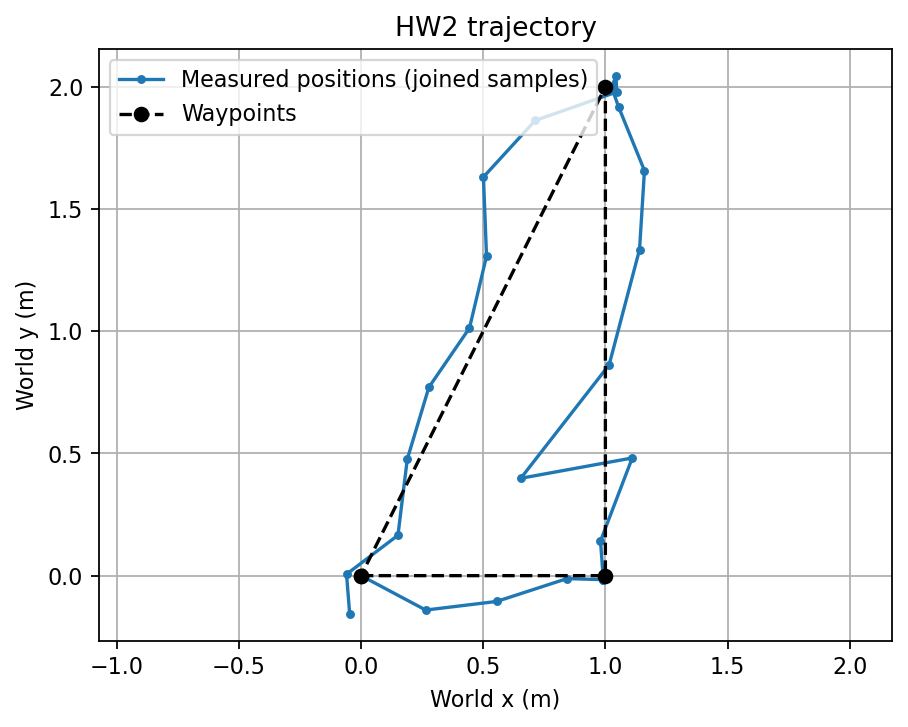
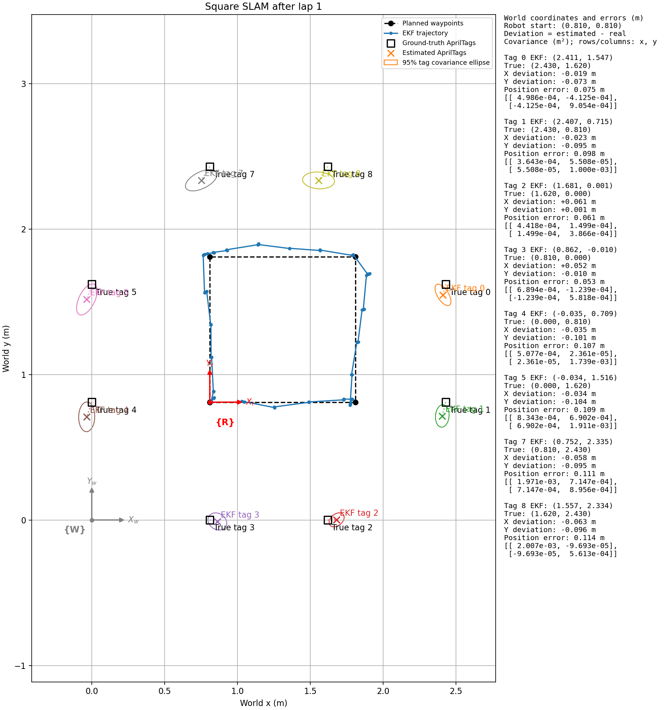
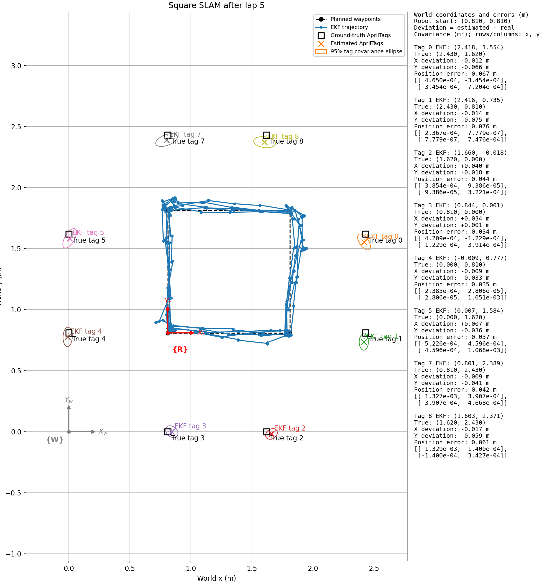
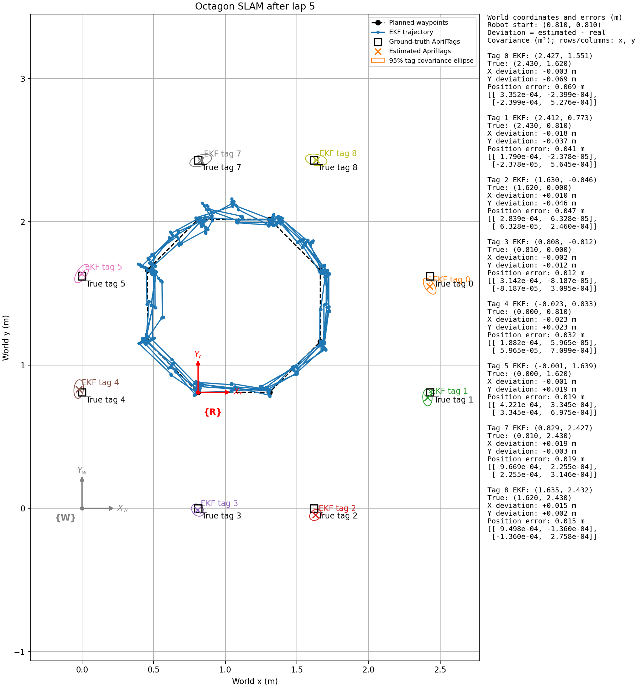
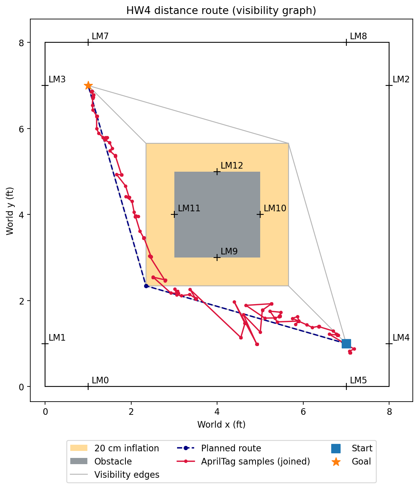
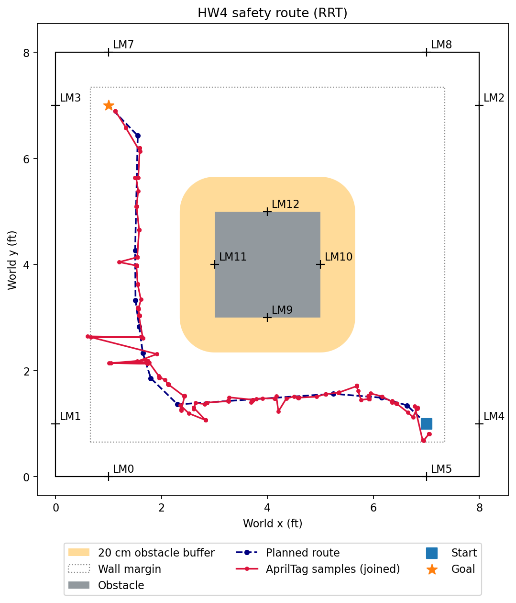

# CSE 276A — Introduction to Robotics

ROS 2 coursework projects covering **differential-drive control**, **AprilTag-based localization**, **EKF-SLAM**, and **obstacle-aware motion planning** on a mobile robot. The assignments build on each other, progressing from calibrated motion commands to feedback-based autonomous navigation.

## Assignments at a glance

| Homework | Topic | Implementation | Report |
|---|---|---|---|
| **HW1** | Open-loop waypoint tracking and motor calibration | [`waypoint_controller.py`](robot_control/robot_control/waypoint_controller.py) | [HW1 report](reports/hw1_report.md) |
| **HW2** | Camera-calibrated AprilTag localization and closed-loop waypoint control | [`hw2_waypoint_controller.py`](robot_control/robot_control/hw2_waypoint_controller.py) | [HW2 Markdown report](reports/hw2_report.md) · [Original PDF](reports/original_pdfs/hw2_report.pdf) |
| **HW3** | Online EKF-SLAM with unknown landmarks and loop-closure evaluation | [`hw3_slam.py`](robot_control/robot_control/hw3_slam.py) | [HW3 Markdown report](reports/hw3_report.md) · [Original PDF](reports/original_pdfs/hw3_report.pdf) |
| **HW4** | Minimum-distance visibility graph vs. clearance-aware RRT path planning | [`hw4_plan.py`](robot_control/robot_control/hw4_plan.py) · [`hw4_controller.py`](robot_control/robot_control/hw4_controller.py) · [`hw4_plot.py`](robot_control/robot_control/hw4_plot.py) | [HW4 Markdown report](reports/hw4_report.md) · [Original PDF](reports/original_pdfs/hw4_report.pdf) |

## HW1 — Open-loop waypoint navigation

Implemented a differential-drive waypoint controller in Python/ROS 2. It reads target poses from `waypoints.txt`, turns toward each position, travels using **calibrated timed left/right motor commands**, and adjusts final heading. Calibrated straight-line movement and 90° turns; the first run closely followed the prescribed path, while the second exposed accumulation of slip/calibration errors without visual feedback.

**Explore:** [Report](reports/hw1_report.md) · [Controller](robot_control/robot_control/waypoint_controller.py) · [Waypoints](robot_control/robot_control/waypoints.txt) · [Run 1](https://youtu.be/ftRfKOUswD8) · [Run 2](https://youtu.be/_GLnsWuF6MI)

## HW2 — Closed-loop AprilTag waypoint control

Extended waypoint navigation with onboard-camera detection of **four known AprilTags** and robot-pose recovery through world/tag/camera transformations. Implemented stationary feedback after forward segments, estimated-heading corrections, geometric rejection of invalid detections, and recovery scans when landmarks disappear. Camera calibration and a **0.06 m position / 6° heading** waypoint tolerance supported repeatable feedback control. All three estimated target-position errors were within tolerance, with measured values **4.50, 1.29, and 5.70 cm**. Estimated total commanded wheel-equivalent travel was **6.575 m**, including turning. These position errors are based on visual estimates rather than independent ground-truth measurements.

**Explore:** [Full report](reports/hw2_report.md) · [Controller](robot_control/robot_control/hw2_waypoint_controller.py) · [Trajectory figure](reports/images/trajectory.png) · [Log directory](robot_control/robot_control/hw2_logs/)



## HW3 — EKF-SLAM and uncertainty-aware control

Built an **Extended Kalman Filter SLAM** pipeline that estimates robot pose and a dynamically growing map of AprilTag landmarks **without assuming landmark coordinates or even a fixed number of tags**. Used calibrated differential-drive prediction, range-bearing measurement updates, Jacobians and covariance propagation, new-landmark initialization, and revisitation updates. Added a stop–turn–move–observe controller with repeated stationary observations. Tested **five laps** of square and octagon trajectories, analyzing estimated trajectories, 95% landmark covariance ellipses, measured loop closure, and landmark error relative to a separately measured ground-truth map.

The square map's mean landmark error decreased from **9.10 cm (lap 1)** to **4.95 cm (lap 5)**. The octagon achieved **3.56 cm (lap 1)** and **3.18 cm (lap 5)**, with a **2.83 cm** physical loop-closure error after lap 5. Additional observations did not always improve accuracy monotonically.

**Explore:** [Full report](reports/hw3_report.md) · [EKF-SLAM source](robot_control/robot_control/hw3_slam.py) · [Square run video](https://youtu.be/w5WYQbhZ0G0) · [Octagon run video](https://youtu.be/0rQwvqEpVzk)

| Square, 1 lap | Square, 5 laps | Octagon, 5 laps |
|:---:|:---:|:---:|
|  |  |  |

## HW4 — Visibility graph and clearance-aware RRT

Designed two geometric planners for an **8 ft × 8 ft workspace** with a **2 ft × 2 ft central obstacle** and a **20 cm inflation buffer**. The minimum-distance method constructs a visibility graph and uses **Dijkstra's algorithm**. The safety-oriented method samples collision-free points with an **RRT**, integrates obstacle/wall clearance into its path cost, and shortcut-optimizes the result. Both plans were tested using a shared AprilTag-feedback controller with clustered localization measurements and repeated short forward motions.

The visibility graph found a **2.954 m** route; RRT (seed 276) produced a **3.344 m** route. The RRT improved **minimum interior clearance from 0.81 ft to 1.36 ft** but increased mean execution time from **72.67 s to 125.00 s**, while both achieved approximately **4.6 cm mean final-position error** across three trials. The optimization is clearance-*aware*, not a mathematical guarantee of maximum possible minimum clearance.

**Explore:** [Full report](reports/hw4_report.md) · [Planner](robot_control/robot_control/hw4_plan.py) · [Robot controller](robot_control/robot_control/hw4_controller.py) · [Plots](robot_control/robot_control/hw4_plot.py)

| Shortest path (visibility graph) | Safety path (RRT) |
|:---:|:---:|
|  |  |

## Repository structure

```text
CSE276/
├── README.md                        # This file
├── reports/
│   ├── hw1_report.md
│   ├── hw2_report.md
│   ├── hw3_report.md
│   ├── hw4_report.md
│   ├── original_pdfs/               # Original HW2–HW4 submissions
│   └── images/                      # HW2 trajectory, HW3 maps, HW4 plots
├── robot_control/
│   └── robot_control/
│       ├── waypoint_controller.py   # HW1
│       ├── hw2_waypoint_controller.py
│       ├── hw3_slam.py
│       ├── hw4_plan.py
│       ├── hw4_controller.py
│       ├── hw4_plot.py
│       ├── landmarks.py
│       └── waypoints.txt
├── apriltag_ros/                     # AprilTag detection and transforms
└── robot_vision/                     # Camera and vision ROS 2 package
```

## Supporting code and ROS 2 packages

- [AprilTag ROS 2 integration](apriltag_ros/) — tag detection and pose estimation.
- [Robot vision package](robot_vision/) — camera configuration and acquisition.
- [Robot control package](robot_control/) — control, logging, navigation and plotting scripts.
- [Landmark configuration](robot_control/robot_control/landmarks.py) — landmark-related code.
- [Motor controller](robot_control/robot_control/motor_control.py) — actuator command interface.

> **Integration:** This archive contains only `README.md` and `reports/`. Extract or copy both into the **root** of your existing `CSE276/` repository. Code hyperlinks resolve against the source files already in your workspace; source code is not duplicated in this documentation archive. HW4 video links remain unfilled in the supplied report.
