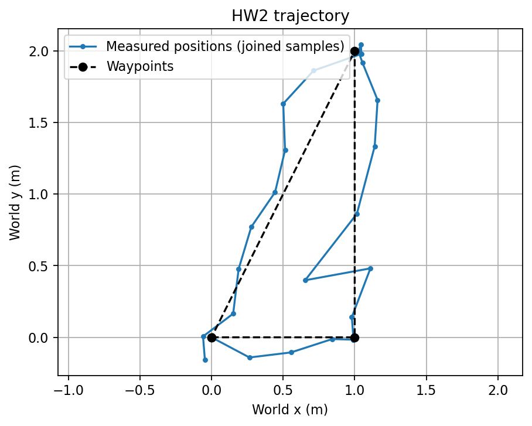

# CSE 276A — Homework 2 Report

> Markdown transcription of the submitted report. For original equation layouts, tables, and diagrams, see the [source PDF](original_pdfs/hw2_report.pdf).


<!-- Source PDF page 1 -->
```text
Xinzi Huang: 200230357
Runtong Liang: 200479676
```

## a. Description of the Closed-Loop Controller

I extended my HW1 open-loop controller by adding visual feedback from AprilTags. The robot follows the waypoint sequence (0, 0, 0) →(1, 0, 0) →(1, 2, π) →(0, 0, 0), where positions are measured in metres and headings in radians. Each individual movement uses calibrated motor commands and timing, but the overall controller is closed-loop because it measures the robot’s pose after movements and uses this feedback to calculate corrections.

```text
Camera and
image processing
```

```text
Calibrated images
```

```text
AprilTag detector
```

```text
Camera-to-tag poses
Known AprilTag                                                       Known
Motion changes          Robot pose     transforms    positions and
camera viewpoint            estimation              camera mount-
ing positions
World x, y, heading
```

```text
Waypoint     Target pose
Waypoint file
controller
```

```text
Left and right
motor commands
```

```text
Motor controller
and robot
```

The camera provides images to the AprilTag detector, which identifies visible tags and estimates their poses relative to the camera. The pose estimator combines these observations with the known AprilTag map and locations and camera mounting transform to obtain the robot’s world position and heading. The waypoint controller compares this estimate with the target and sends left and right wheel commands to the motor controller.

For each waypoint, the robot first turns toward the target and drives forward by at most 0.3 m. It then stops, obtains a new pose estimate, and recalculates the remaining distance and direction. This repeats until the estimated position is within 0.06 m of the target. The robot then corrects its heading until the angular error is within 6◦. All angular errors are wrapped to the interval from −π to π to select the shorter turning direction.

The forward motor commands are 0.38 for the left wheel and 0.40 for the right wheel, with a calibrated speed of approximately 0.57 m/s (mainly for calculating the time). Turning uses opposite wheel commands of magnitude 0.5 and an assumed turning rate of 3.8 rad/s. Movement durations are calculated by dividing the requested distance or angle by the corresponding calibrated speed.

- Camera and image processing: Captures images and corrects lens distortion.
- AprilTag detector: Identifies tags and estimates their poses relative to the camera.
- Robot pose estimation: Combines tag observations and known transforms to estimate the robot’s
world position and heading.

<sub>Source page 1 of 6 · [View original PDF](original_pdfs/hw2_report.pdf#page=1)</sub>

---

<!-- Source PDF page 2 -->
- Known AprilTag positions and camera mounting positions: Provides tag world poses and
the camera’s pose relative to the robot.

- Waypoint controller: Uses the current and target poses to calculate motor commands.
- Waypoint file: Stores the target positions and headings in order.
- Motor controller and robot: Executes wheel commands to move and turn the robot.
## b. Description and Placement of Landmarks

I used four AprilTags as landmarks. Each has a unique ID associated with a manually specified world position and orientation.

```text
Tag ID  x (m)  y (m)  Height (m)  Facing direction
```

```text
0      1.50    0.00       0.11           180◦
1      1.00    2.50       0.11         −90◦
2      0.00    2.00       0.11             0◦
3      -0.25    -0.50      0.11          63.434◦
```

The facing direction describes where the printed face points: 0◦corresponds to +world x, and 90◦corresponds to +world y. All four tags have a printed rotation of 90◦counterclockwise when viewed from the front.

The tags surround the route and face toward the navigation area. Tag0 provides a reference for the first travel to the second way-point as it face the robot directly in the segment. Tag 0 also helps the robot to adjust it’s heading for the last way-point when it returns to the origin. Tag1 cover the next journey for the robot going towards the third way-point. Tag2 plays a key role helping robot knowing it position after facing -180 degrees at the third way-point. Without Tag2, robot will definitely lost it’s position when facing -180 at (1, 2). Tag3 is placed at (-0.25, -0.5) and pacing 63.434 degrees to help the robot on it’s way back to the origin. it is placed at 63.434 degrees calculated by arctan(2) to make it directly fact the robot on it’s way back to the origin form the third way-point.

The world origin is the robot’s starting position, with its initial forward direction along +x and +z pointing upward. The vehicle frame uses x forward, y left, and z upward. The camera optical frame uses x right, y down, and z forward. The camera is mounted 0.097 m forward and 0.12 m above the vehicle origin. The initial robot pose is (0, 0, 0).

## c. Car Pose Estimation and Noise Handling

The AprilTag detector estimates each visible tag’s position and orientation relative to the camera. Since the tag’s world pose is known, this observation can be inverted and combined with the camera mounting transform to recover the robot’s world pose.

Using TAB to represent a transform from frame B into frame A:

```text
Tworld,robot = Tworld,tag T camera,tag−1       Tcamera,robot.
```

The translation component gives the robot’s world position.  Its heading is extracted from the rotation matrix using atan2(R21, R11). The camera mounting transform accounts for both its physical offset and the difference between optical and vehicle coordinate axes.

To reduce unreliable estimates, the controller rejects unknown tags, unexpected reference frames, invalid quaternions, and non-finite transforms. It also rejects tags behind the camera or outside a distance range

<sub>Source page 2 of 6 · [View original PDF](original_pdfs/hw2_report.pdf#page=2)</sub>

---

<!-- Source PDF page 3 -->
of 0.05–4.0 m. Observations must be no more than three seconds old and must have been captured after the current stationary measurement request.

Additional checks reject robot poses with a vertical displacement greater than 0.20 m or a tilt greater than 25◦from upright. These conditions are inconsistent with normal operation on a flat floor and help remove large pose-estimation errors.

If several valid observations appear in the same message, the newest is selected, with the nearest tag preferred when timestamps are equal. The implementation does not average observations.  I chose this approach to keep the controller simple while filtering clearly invalid estimates. However, small measurement errors and differences between tag estimates can still affect the reported position. Small errors still exists if you look at the graph which shows more error than the actrual trajectory of the robot in the video.

## d. Handling Missing Landmark Detections

When no valid landmark pose is available, the robot stops and initially waits for up to three seconds while processing incoming observations to give some more chances for positions to arrive. If no valid pose arrives, it turns approximately 20◦counterclockwise and waits for one second. Waiting for 1 second is necessary since it give time for the robot to process the observed tag and position. This search repeats until a valid landmark is detected.

After each search turn, old observations are invalidated so that the controller uses an image captured after the movement. Once localization succeeds, the robot recalculates the required movement using its updated position and heading.

This strategy allows recovery when landmarks are temporarily outside the camera’s field of view. However, it adds pauses and rotation to the route.  If the required final heading faces away from all landmarks, searching and heading correction can repeat. Therefore, landmark placement must provide visibility near the required waypoint orientations. We also calibrated the camera using checker board for better localization performance.

## e. Custom Landmark Detection

This section is not applicable because I selected AprilTags rather than a custom landmark recognition method. AprilTag IDs provide a direct correspondence between detections and entries in the landmark map, allowing the implementation to focus on pose estimation and closed-loop navigation.

## f. Smoothness of the Car’s Motion

The robot uses a stop-and-measure strategy rather than continuous motion. Each forward segment is limited to 0.3 m, after which the robot stops and obtains visual feedback. Each movement also includes approximately 0.2 seconds of settling time.

This approach provides frequent opportunities to correct motion errors, but produces noticeable pauses between segments.  Heading corrections and landmark searches introduce additional turns and delays. Motor commands also change directly between stationary and moving states, without acceleration or deceleration ramps.

The resulting motion is therefore segmented rather than fully smooth. This is a trade-offmade to simplify the controller and obtain observations while stationary. Smoother motion could be achieved by gradually changing motor commands and processing reliable pose feedback continuously during movement.

<sub>Source page 3 of 6 · [View original PDF](original_pdfs/hw2_report.pdf#page=3)</sub>

---

<!-- Source PDF page 4 -->
## g. Total Moving Distance

I use metres as the distance unit. The ideal translational distance along the requested route is:

```text
√
Dreference = 1 + 2 +  5 ≈5.236 m.
```

This is the nominal route length, not the actual distance travelled. Position corrections and deviations can increase the translational distance, while heading corrections and landmark searches add rotation.

To include rotation, I use the average absolute distance travelled by the two wheels. For an ideal in-place turn through an angle θ radians, with wheel separation b metres, each wheel travels b|θ|/2. The total distance can therefore be expressed as:

```text
b
Dtotal = Dtranslation +  ∑︂ |θi|.
2
i
```

All turns, including correction and landmark-search turns, must be included.

```text
Quantity                         Result
```

```text
Distance unit                   1 m
Wheel separation, b               0.130 m
Total translational travel          5.927 m
Total absolute rotation            9.973 rad
Total distance including rotation  6.575 m
```

These totals are command-based estimates calculated by accumulating the requested forward distances and absolute turning angles, including landmark-search turns. Using the wheel separation of 0.130 m, the total distance including rotation is:

```text
0.130
Dtotal = 5.927 +      (9.973) ≈6.575 m.
2
```

The translational travel exceeded the ideal route length of 5.236 m by approximately 0.691 m, or 13.2%.

## h. Location Error at Each Waypoint

For each waypoint, translation error is calculated as the Euclidean distance between the final position and the target:

```text
√︂                               eposition =   (xmeasured −xtarget)2 + (ymeasured −ytarget)2.
```

Rotation error is the absolute wrapped difference between the final and target headings, reported in degrees:

```text
180
eheading = |wrap(θmeasured −θtarget)|       .
π
```

```text
Waypoint       Target position  Target heading  Translation error  Rotation error
(m)               (◦)            (m)               (◦)
```

```text
First target            (1, 0)             0.0            0.0450           2.460
Second target          (1, 2)           179.9           0.0129           5.871
Return to start        (0, 0)             0.0            0.0570           3.823
```

<sub>Source page 4 of 6 · [View original PDF](original_pdfs/hw2_report.pdf#page=4)</sub>

---

<!-- Source PDF page 5 -->
These errors were calculated from the final AprilTag-based pose estimate at each waypoint after heading correction.  All three estimated translation errors were within the 0.06 m position tolerance, and all estimated heading errors were within the 6◦heading tolerance.

The largest translation error was 0.0570 m at the return to the starting position. The largest heading error was 5.871◦at the second target. These results describe errors relative to the estimated pose; they are not independent ground-truth measurements of physical accuracy. The controller’s 0.06 m position tolerance and 6◦heading tolerance apply to its estimated pose, rather than guaranteeing the same physical accuracy. Camera pose noise and landmark measurement errors can cause differences between the estimated and actual position. Note that I did not include the initial way-point of (0, 0, 0) since I place the robot in that exact position. We can just assume the Error is 0.

## i. Two-Dimensional Trajectory



Figure 1. Estimated robot positions and the reference waypoint route.

The trajectory plot displays estimated world x and y positions as individual dots. The requested waypoints are connected by dashed lines, and both axes use equal scaling so that distances and route geometry are represented consistently.

The initial point is the known starting position; subsequent points are calculated from AprilTag observations. The current code records positions after forward movements and heading corrections.

## j. reflection on the overall performance

Overall, the algorithm performed very well, allowing the robot to follow the route and reach each waypoint accurately. The position tolerance of 0.06 m and heading tolerance of 6 degrees provided a good balance between accuracy and progress. Smaller tolerances caused the robot to keep making adjustments at the waypoints, while these settings allowed it to reach an acceptable pose and continue. Visually, the robot appeared to move directly onto each waypoint marker and align closely with the requested heading. The recorded AprilTag-based estimates were also within both tolerances at every waypoint.

<sub>Source page 5 of 6 · [View original PDF](original_pdfs/hw2_report.pdf#page=5)</sub>

---

<!-- Source PDF page 6 -->
One particularly successful aspect was the robot’s ability to recover when it lost sight of the landmarks. It could rotate to search for an AprilTag, recover its position, and continue toward the next waypoint without manual assistance. The controller also worked well when I picked up the robot and placed it somewhere else during the route.  After obtaining a new observation, it recalculated the direction and distance to the target and resumed navigation. This demonstrated the value of closed-loop feedback: the robot could respond to unexpected changes in its actual position instead of relying only on its previous movement commands.

Although the stop-and-measure approach introduced pauses, it made the robot’s behavior easy to observe and gave it frequent opportunities to correct errors. These results gave me confidence in the controller’s effectiveness and showed that a relatively simple algorithm, combined with reliable visual feedback and carefully placed landmarks, can achieve accurate and adaptable navigation.

Video Demonstration and Coordinate Frames

A short video demonstrating the robot’s waypoint navigation, position and heading corrections, and overall performance is available at:

```text
https://youtu.be/e297k4--J_Y
```

Remember to change the quality to HD. I don’t know why everytime I open it shows a blur 240p. The coordinate frames and initial pose are defined as follows:

- Sensor coordinate frame: The camera optical frame uses +x to the right, +y downward, and +z
forward along the viewing direction. The camera is mounted 0.097 m forward and 0.12 m above the vehicle origin.

- Vehicle coordinate frame: The vehicle frame uses +x forward, +y to the robot’s left, and +z
upward.

- World coordinate frame: The world origin is the robot’s initial position(0, 0, 0). The +x axis
follows its initial forward direction, +y points to its initial left, and +z points upward. This frame remains fixed as the robot moves.

- Robot start pose: The robot starts at (x, y, θ) = (0, 0, 0), with position measured in metres and
heading in radians. Its initial heading is along the world’s +x axis, and positive heading angles are counterclockwise when viewed from above.

Code location  The code is in robot control/robot control/hw2 waypoint controller.py.

AI assistance disclosure   I used ChatGPT to help complete this work. However, I understand all the code, and the ideas and approach are my own.

<sub>Source page 6 of 6 · [View original PDF](original_pdfs/hw2_report.pdf#page=6)</sub>

---

## Key results (structured reference)

| Waypoint | Target (m) | Position error (m) | Heading error (°) |
|---|---|---:|---:|
| First target | (1, 0) | 0.0450 | 2.460 |
| Second target | (1, 2) | 0.0129 | 5.871 |
| Return to start | (0, 0) | 0.0570 | 3.823 |

- Nominal translational route: **5.236 m**; commanded translational travel: **5.927 m**; command-based total including rotation: **6.575 m**.
- These errors are based on estimated AprilTag poses, not independent physical ground truth.
