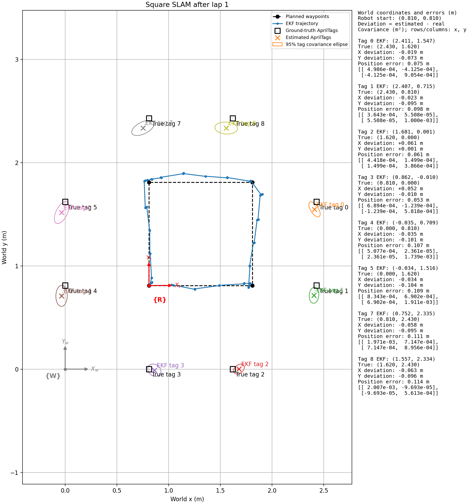
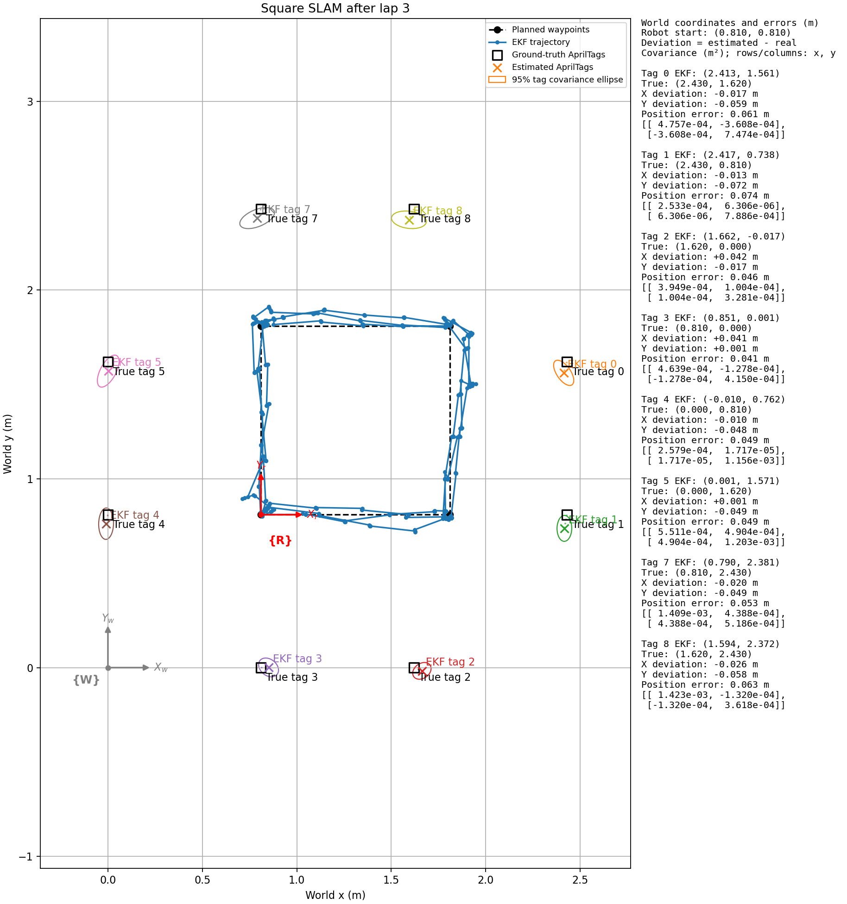
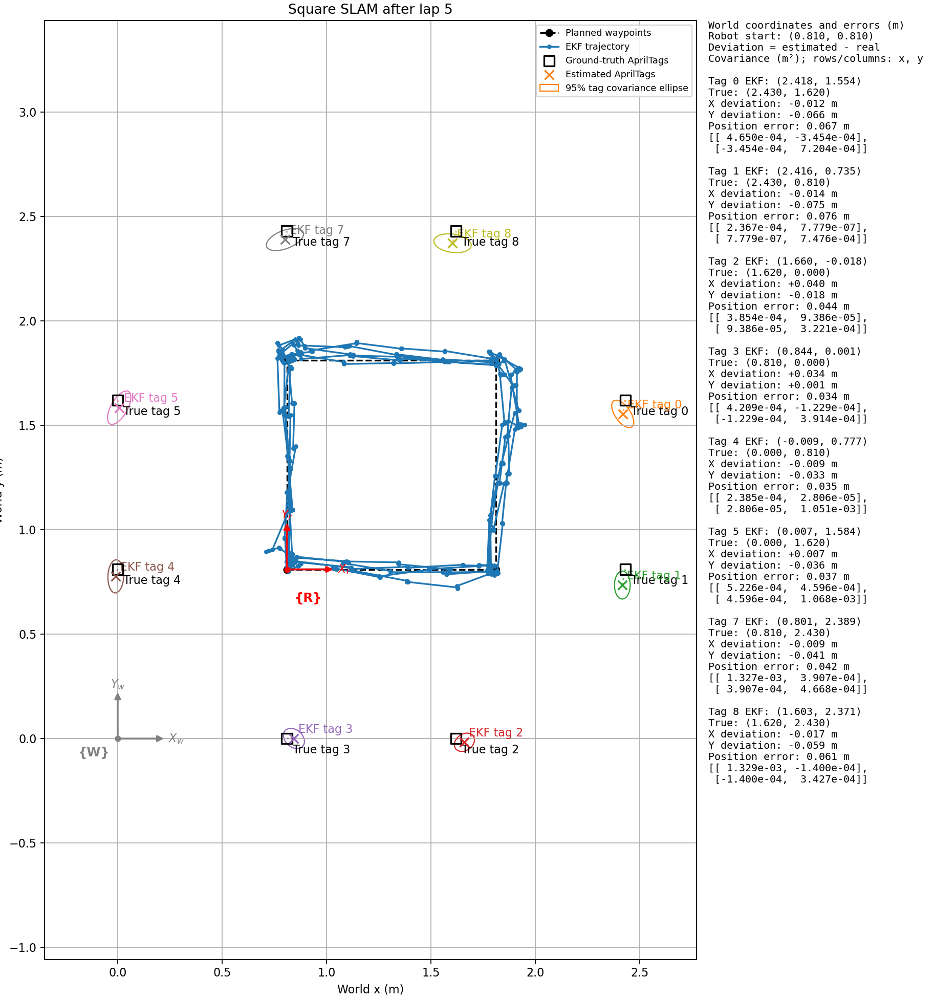
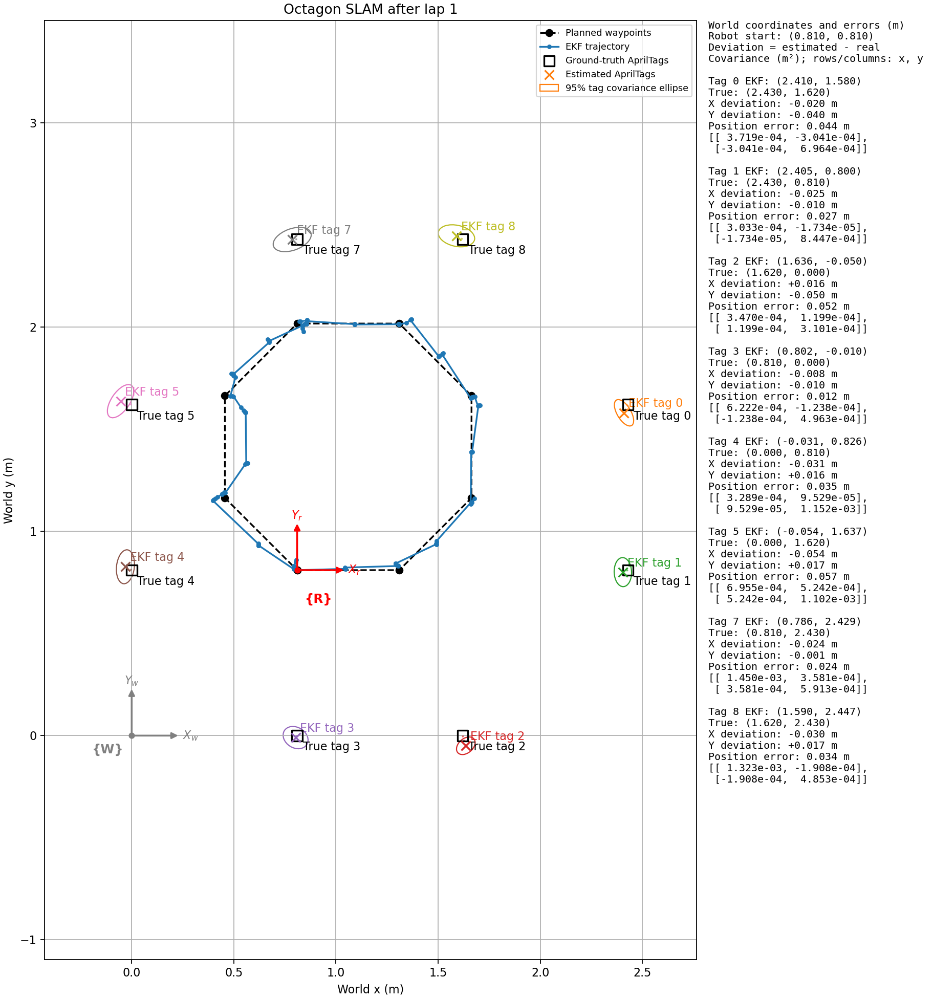
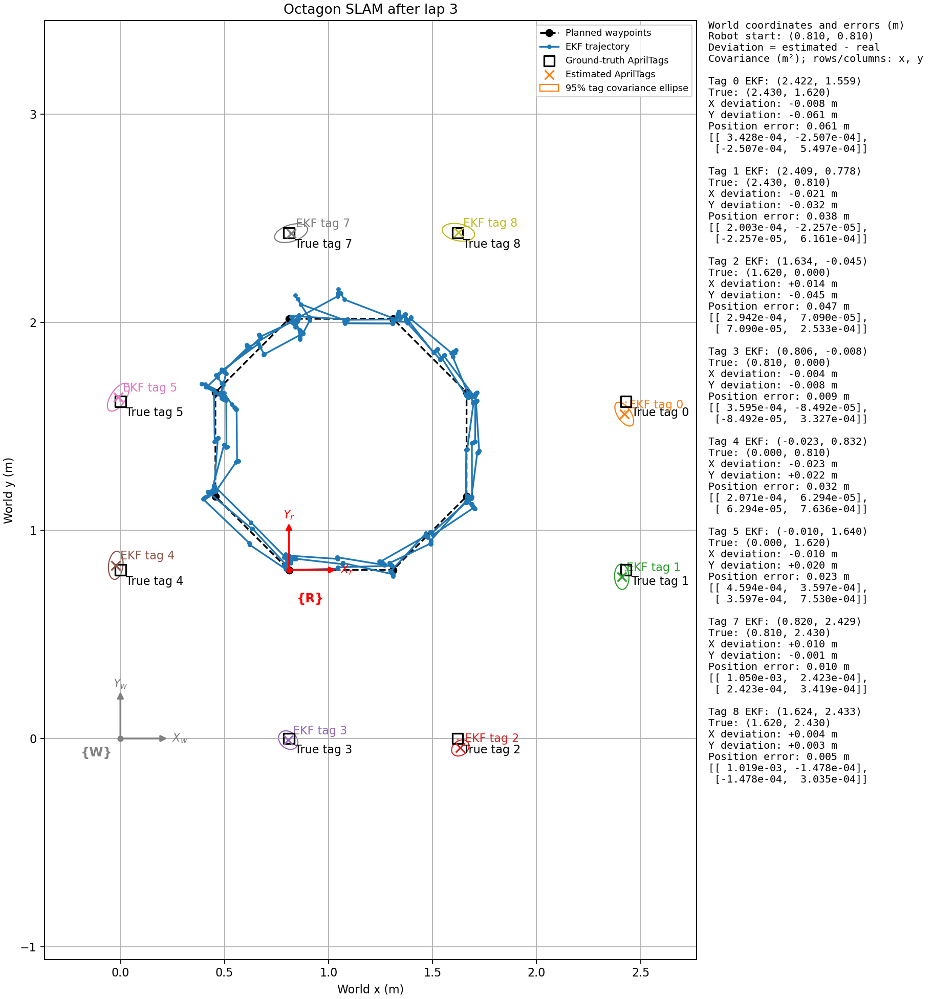
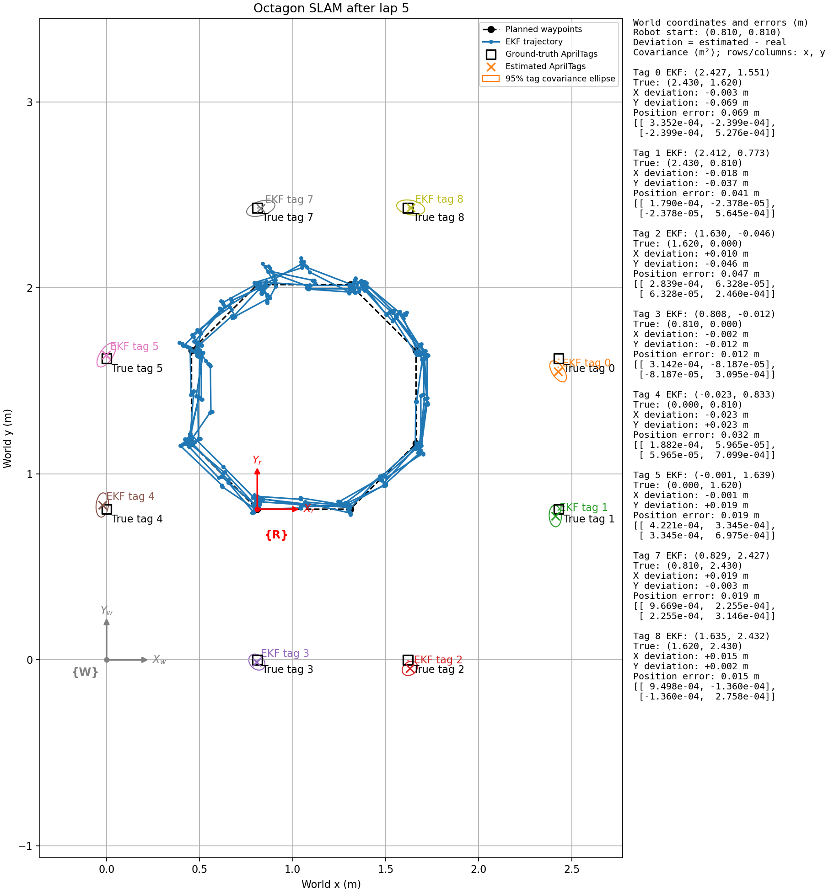

# CSE 276A — Homework 3 Report

> Markdown transcription of the submitted report. For original equation layouts, tables, and diagrams, see the [source PDF](original_pdfs/hw3_report.pdf).


<!-- Source PDF page 1 -->
```text
Xinzi Huang: 200230357
Runtong Liang: 200479676
```

## 1 Experimental Setup

### 1.1 Ground-truth environment

We constructed a square environment measuring 2.43 m × 2.43 m (approximately 8 ft × 8 ft), with world-frame origin at its bottom-left corner, +x pointing right and +y pointing upward in the top-down view. Eight tag36h11 AprilTags were placed along the boundary, two per side. Adjacent AprilTags spaced 0.81 m apart along each wall. The measured robot start was (0.81, 0.81) m. These world coordinates were used only to align plots and calculate evaluation errors, not to initialize the SLAM landmarks or provide localization measurements.

```text
yW
0.81 m        0.81 m        0.81 m
```

```text
Tag 7       Tag 8
```

```text
0.81 m
```

```text
Tag 5                                     Tag 0
```

```text
m
2.43                                                     0.81 m
```

```text
Tag 4                                     Tag 1
Start (0.81, 0.81)
```

```text
0.81 m
```

```text
xW
(0, 0)          Tag 3       Tag 2
```

```text
2.43 m
```

*Figure 1: Top-down ground-truth layout. Coordinates represent tag-center positions in metres. The tag identifiers*

are actual detector IDs, not sequential array indices.

## 2 EKF-SLAM Algorithm

### 2.1 Closed-Loop Waypoint Control

We implemented a closed-loop waypoint controller using the robot pose estimated by EKF-SLAM. Unlike HW2, which used known AprilTag positions to determine the robot pose, our HW3 controller does not require prior knowledge of landmark positions when updating the filter. The robot uses a stop–turn–move–observe controller, as shown in Fig. 2. The robot executes short motion commands and uses AprilTag observations to update its estimated pose. The controller compares the estimated pose with the target waypoint and computes the necessary heading correction and forward distance. We limit each forward command to 0.10-0.25 m to reduce accumulated motion error and allow frequent measurement updates. After each turning or forward movement, we perform two stationary AprilTag observation passes. The first pass includes the EKF motion prediction, followed by a measurement update; the second pass performs another

<sub>Source page 1 of 9 · [View original PDF](original_pdfs/hw3_report.pdf#page=1)</sub>

---

<!-- Source PDF page 2 -->
measurement update without additional motion prediction. This allows the controller to incorporate additional visual feedback before executing the next command. For a target waypoint (xt, yt, θt) and the current EKF pose (ˆx, ˆy, ˆθ), the desired heading and heading correction are computed as

```text
θd = atan2(yt −ˆy, xt −ˆx),                                          (1)
```

```text
∆θ = wrap(θd −ˆθ).                                             (2)
```

The commanded forward distance is

```text
(︂                               d = min                                                 0.10, √︁(xt −ˆx)2 + (yt −ˆy)2 )︂ .                                   (3)
```

We accept a waypoint when its estimated position error is within 0.05 m and correct its final heading to within 5◦.  This feedback mechanism helps compensate for wheel slip, turning inaccuracies, and accumulated motion errors.

New camera viewpoint            Camera and

```text
after robot motion             image processing
```

```text
Calibrated images
```

```text
AprilTag detector
```

```text
Range and bearing
```

```text
EKF-SLAM                    Motion model, Q
pose and map estimation             Camera mount, R
```

```text
Estimated pose
```

```text
Target waypoint
Executed motion         Waypoint controller                                                                                                    (xt, yt, θt)
(EKF prediction)
Turn / forward
commands
Motor controller
and robot
```

*Figure 2:  Closed-loop EKF-SLAM waypoint control.  Motor commands move the robot, while new AprilTag*

observations update the estimated robot pose and landmark map. The updated pose is fed back to the waypoint controller for subsequent motion corrections.

### 2.2 State and observations

The dynamically sized joint state consists of the robot pose (xr, yr) and the estimated landmark positions mj:

```text
x = [︁xr  yr   θr  m1x  m1y    · · · mNx  mNy ]︁T ∈R3+2N,                        (4)
```

where N  is the number of distinct tags observed so far, not a fixed count. A tag ID maps to its corresponding state index. Each observed tag provides a range–bearing measurement in the robot frame,

```text
zj = [︁rj  βj ]︁T ,      rj = √︂ x2bj + y2bj,   βj = atan2(ybj, xbj),                        (5)
```

where (xbj, ybj) is the observed tag-center position relative to the robot after camera-to-robot transformation. Tag

```text
measurements are processed individually, in increasing tag-ID order. Angles are wrapped to (−π, π].
```

<sub>Source page 2 of 9 · [View original PDF](original_pdfs/hw3_report.pdf#page=2)</sub>

---

<!-- Source PDF page 3 -->
### 2.3 Prediction model, F and G

```text
For body-frame motion u = [f, ℓ, ∆θ]T , the robot pose evolves as
```

```text
x+r = xr + f cos θr −ℓsin θr,
y+r = yr + f sin θr + ℓcos θr,                                         (6)
θ+r = wrap(θr + ∆θ),
```

while landmark coordinates remain unchanged. Let ∆x = f cos θr−ℓsin θr and ∆y = f sin θr+ℓcos θr. Linearizing the motion function with respect to the joint state yields

```text
F = I3+2N,     F1,3 = −∆y,   F2,3 = ∆x.                                 (7)
```

The Jacobian with respect to body-frame control noise is

```text
⎡cos θr  −sin θr  0 ⎤
sin θr   cos θr   0
G =                                                                 (8)
0       0     1                                                                                              ⎢⎢⎣                             ⎥⎥⎦.
02N×3
```

The filter prediction is

```text
ˆx−= f(ˆx, u),   Σ−= FΣF T + GQGT .                                  (9)
```

Here F is the state-transition Jacobian, not a fixed linear motion matrix, and G maps body-frame motion uncertainty into the joint state.

### 2.4 Measurement model and H

For a known landmark j, let dx = mjx −xr, dy = mjy −yr, q = d2x +d2y, and ρ = √q. The predicted observation is

```text
[︃          ρ                   ]︃
hj(x) =                                            .                                  (10)
wrap(atan2(dy, dx) −θr)
```

```text
Its Jacobian Hj ∈R2×(3+2N) has nonzero blocks
```

```text
[︃−dx/ρ  −dy/ρ   0 ]︃            [︃dx/ρ   dy/ρ ]︃
Hj,r =                                     ,    Hj,m =                          ,                      (11)
dy/q   −dx/q  −1             −dy/q  dx/q
```

with zeros for all other landmarks. The innovation, innovation covariance, and Kalman gain are

```text
νj = zj −hj(ˆx−),  Sj = HjΣ−HTj + R,  Kj = Σ−HTj S−1j   ,                      (12)
```

```text
where the bearing component of νj is wrapped. The update is
```

```text
ˆx+ = ˆx−+ Kjνj,  Σ+ = (I −KjHj)Σ−(I −KjHj)T + KjRKTj .                    (13)
```

The Joseph covariance form is used for numerical stability; the result is symmetrized. A near-zero predicted range is skipped to avoid a singular Jacobian.

### 2.5 Initialization and landmark management

The robot-frame origin is defined at the starting pose, so the implementation initializes ˆx0|0 = [0, 0, 0]T and Σ0|0 = 03×3. This choice defines a local reference frame and implies that the robot does not knows its measured world pose. When a new ID is detected, the inverse range–bearing model initializes its position by

```text
[︃xr + r cos(θr + β)]︃
mj =                                 .                                      (14)
yr + r sin(θr + β)
```

Its robot-state and observation Jacobians are

```text
[︃1  0  −r sin(θr + β)]︃          [︃cos(θr + β)  −r sin(θr + β)]︃
A =                                      ,  B =                                                 .                  (15)
0  1   r cos(θr + β)             sin(θr + β)   r cos(θr + β)
```

<sub>Source page 3 of 9 · [View original PDF](original_pdfs/hw3_report.pdf#page=3)</sub>

---

<!-- Source PDF page 4 -->
The new landmark covariance is Σjj = AΣrrAT + BRBT , and cross-covariances with the existing joint state are Σj,old = AΣr,old. These blocks augment the state and covariance. When a tag leaves the field of view, its state remains in the map and is propagated through the joint covariance, but there is no measurement update for it. When the landmark is observed again, its ID retrieves the existing landmark state. The standard EKF measurement update corrects the robot pose and correlated landmarks.  The repeated observations provide EKF loop-closure corrections.

### 2.6 Motion and Measurement Uncertainty

### 2.6.1 Motion Model Uncertainty

We determine the system noise by testing 20 turns (ten 90◦turns and ten 45◦turns) and 20 forward motions. The recorded motion means and sample standard deviations are summarized in Table 1.

```text
Motion                Mean    Std. dev.
90◦rotation                 91.4◦     5.3375◦
45◦rotation                 45.5◦     3.4721◦
Forward displacement x   25.25 cm   1.184 cm
Lateral displacement y      0.4 cm    0.516 cm
Forward heading change    −0.5◦      1.00◦
```

*Table 1: Motion-model means and standard deviations.*

Since the measured means are close to the commanded motions, we use the nominal motion vectors:

```text
ustraight = [0.25, 0, 0]T ,     u45 = [0, 0, π/4]T ,     u90 = [0, 0, π/2]T .                  (16)
```

We compute the sample covariance using

```text
N                           N
1                                     1
Q =     ∑︂(ui −¯u)(ui −¯u)T ,    where ¯u =  ∑︂ ui and ui = [︁∆xi  ∆yi  ∆θi ]︁T .        (17)
```

N −1                     N

```text
i=1                                      i=1
```

We divide by N −1 rather than N to obtain the unbiased sample covariance estimate. Using the measured standard deviations, we get:

```text
⎡ 1.402778 × 10−4   −3.333333 × 10−5    0  ⎤
Qstraight,measured ≈                                     −3.333333 × 10−5   2.666667 × 10−5     0  ⎦,                 (18)                           ⎣
0                 0          (︁π180 )︁2
```

```text
Q45,measured ≈diag(0, 0, 0.003672),                                   (19)
```

```text
Q90,measured ≈diag(0, 0, 0.008678).                                   (20)
```

For the turns, zero translational components are assumptions because only angular displacement was measured.

### 2.6.2 Measurement Model Uncertainty

The EKF uses AprilTag observations in range-bearing form:

```text
[︃ri ]︃
zi =         ,                                               (21)
ϕi
```

where ri = √︁x2i + y2i  is the measured planar distance from the robot center to the tag in meters, and ϕi is the measured bearing relative to the robot’s heading in radians. We collected repeated stationary AprilTag observations at different distances. The measured biases and standard deviations are shown in Table 2.

<sub>Source page 4 of 9 · [View original PDF](original_pdfs/hw3_report.pdf#page=4)</sub>

---

<!-- Source PDF page 5 -->
```text
Distance  Angle  Range bias  Range std.  Bearing bias  Bearing std.
(m)       (◦)      (cm)        (cm)           (◦)             (◦)
```

```text
0.50      0        1.323       0.0063        -1.062        0.00435
1.00      0        2.678       0.0189        -1.690        0.0020
1.50      0        5.340       0.3200        -1.845        0.0034
```

*Table 2: AprilTag range and bearing measurement errors.*

The measured noise covariance is

```text
[︃   σ2r     Cov(r, ϕ)]︃   [︃1.5183 × 10−8   5.0763 × 10−10 ]︃
Rmeasured =              =                                                        .                (22)
Cov(r, ϕ)     σ2ϕ        5.0763 × 10−10   4.1531 × 10−9
```

### 2.6.3 Covariance Tuning

However, directly using the measured Q and R did not give us an ideal result. The estimated covariances were too small to account for all uncertainties during actual navigation, including wheel slip, motion-model mismatch, and systematic AprilTag measurement errors. A small Q makes the EKF overly confident in its motion prediction, while a small R makes it overly confident in visual measurements. In particular, when R is very small relative to the predicted state covariance, the Kalman gain becomes large, causing the filter to rely heavily on AprilTag observations. This can produce excessive pose corrections when measurements contain unmodeled errors. Therefore, in the final implementation, we use manually selected diagonal covariance matrices informed by our experimental observations. For the 25 cm forward trials, we observed motion errors on the order of 2.5 cm longitudinally, 1.5 cm laterally, and 2◦in heading. To conservatively accommodate additional variation, we set

```text
Qstraight = 2 diag (︁ (0.05)2, (0.03)2, (2π/180)2)︁ ,                             (23)
Q45 = diag(0, 0, 0.015),                                                (24)
Q90 = diag(0, 0, 0.02947759339).                                       (25)
```

The factor of two and the larger base translational deviations make Qstraight deliberately conservative.  Its effective standard deviations are 7.07 cm forward, 4.24 cm lateral, and 2.83◦heading.  Similarly, Q45 and Q90 correspond to heading standard deviations of approximately 7.02◦and 9.84◦. Based on the observed range and bearing variations, we also manually select a fixed measurement covariance:

```text
R = diag (︁ (0.03)2, (2.5π/180)2)︁ .                                    (26)
```

This corresponds to an assumed 3 cm range standard deviation and 2.5◦bearing standard deviation. A constant R does not explicitly model distance-dependent systematic bias. Additionally, our final controller processes two successive fresh stationary AprilTag observation batches after each turn and forward movement, without a second motion prediction. This allows repeated visible landmarks to further refine the joint robot pose and landmark covariance before the next motion command.

## 3 Experimental Results

### 3.1 Estimated trajectories and landmark maps

#### Square trajectory and landmark maps

| After lap 1 | After lap 3 | After lap 5 |
|:---:|:---:|:---:|
|  |  |  |

#### Octagon trajectory and landmark maps

| After lap 1 | After lap 3 | After lap 5 |
|:---:|:---:|:---:|
|  |  |  |

Figures 3 and 4 show trajectories recorded from the EKF state. Black dashed lines are commanded waypoints, blue lines are EKF pose estimates, hollow black squares are measured ground-truth landmark positions, colored crosses are EKF landmark estimates, and ellipses are the 95% marginal landmark covariance regions. For each

```text
√︂2 × 2 landmark covariance Σj, the ellipse principal semiaxes are   χ22,0.95λk, where χ22,0.95 ≈5.991 and λk are its
```

eigenvalues.

<sub>Source page 5 of 9 · [View original PDF](original_pdfs/hw3_report.pdf#page=5)</sub>

---

<!-- Source PDF page 6 -->
## a. After 1 lap                                             (b) After 3 laps

## c. After 5 laps

*Figure 3: Square-route EKF trajectories and landmark maps at laps 1, 3, and 5. Each image includes per-tag*

95% position covariance ellipses and coordinate/error annotations. For comparison only, we transformed the local SLAM coordinates into the world frame using the measured initial robot pose. The robot started at approximately (0.81, 0.81) m, with its heading physically aligned with the world +x axis.

<sub>Source page 6 of 9 · [View original PDF](original_pdfs/hw3_report.pdf#page=6)</sub>

---

<!-- Source PDF page 7 -->
## a. After 1 lap                                             (b) After 3 laps

## c. After 5 laps

*Figure 4: Octagon-route EKF trajectories and landmark maps at laps 1, 3, and 5, with per-tag covariance ellipses.*

<sub>Source page 7 of 9 · [View original PDF](original_pdfs/hw3_report.pdf#page=7)</sub>

---

<!-- Source PDF page 8 -->
### 3.2 Choice of trajectories

```text
The square uses the following local-frame waypoints, with a side length of 1.00 m ≈3.28 ft:
```

```text
(0, 0) →(1, 0) →(1, 1)
→(0, 1) →(0, 0).
```

```text
The octagon uses the following local-frame waypoints, with a side length of 0.50 m ≈1.64 ft:
```

```text
(0, 0) →(0.5, 0) →(0.853553, 0.353553)
→(0.853553, 0.853553) →(0.5, 1.207107)
→(0, 1.207107) →(−0.353553, 0.853553)
→(−0.353553, 0.353553) →(0, 0).
```

Both trajectories fit inside the boundary when translated to the measured start point. The square offers longer straight segments and only four 90◦corners, while the octagon uses shorter segments and eight approximately 45◦corners, allowing more varied viewing directions and potentially better landmark coverage. The trade-off is that the octagon requires more turns, stops, and observation updates per lap, increasing opportunities for motion error and execution time. The square’s corners also make heading errors more consequential during long straight segments. We choose the length of the square to be 1m and the length of the octagon to be 50cm. This is because it is a multiple of the maximum travel length of each move of the robot 10cm or 25 cm. The tradeoff is that the square and the octagon is not at the very center of the map which will make the robot getting much closer to one side of the map than the other side.

### 3.3 Physical loop closure

We measured the robot’s physical displacement from its initial position after each selected completed lap count, separately from the filter’s estimated trajectory. The table reports the supplied component-wise displacement and

```text
observed heading difference. The Euclidean distance is computed as √︁∆x2 + ∆y2.
```

```text
Route     Laps   Physical (∆x, ∆y) (cm)   Closure distance (cm)   Heading error
```

```text
Square       1                        (0, 7)                    7.00              5◦
Square       3                      (4.5, 3)                    5.41              2◦
Square       5                        (4, 4)                    5.66       < 1◦
Octagon      1                      (4.5, 2)                    4.92        ≈1◦
Octagon      3                        (2, 2)                    2.83       < 1◦
Octagon      5                        (2, 2)                    2.83       < 1◦
```

*Table 3: Measured physical closure errors.*

The octagon achieved smaller measured closure error at all three checkpoints. However, closure error is not a direct measurement of absolute localization accuracy along the entire route: a robot may return near its start while still having errors at intermediate waypoints.

### 3.4 Landmark mapping accuracy

For each landmark j, we compare its EKF estimate in the world frame with the measured ground-truth position, using

```text
8
1                        √︂                                                   ∑︂ ej.                  (27)                         ej =                                  (ˆmjx −mGTjx )2 + (ˆmjy −mGTjy )2,     MAEposition =                                                                        8
j=1
```

where the MAE is the mean Euclidean position error, not the mean absolute error.

<sub>Source page 8 of 9 · [View original PDF](original_pdfs/hw3_report.pdf#page=8)</sub>

---

<!-- Source PDF page 9 -->
```text
Route / laps  Tag 0  Tag 1  Tag 2  Tag 3  Tag 4  Tag 5  Tag 7  Tag 8  Mean
```

```text
Square / 1        7.5      9.8      6.1      5.3    10.7    10.9    11.1    11.4    9.10
Square / 3        6.1      7.4      4.6      4.1      4.9      4.9      5.3      6.3    5.45
Square / 5        6.7      7.6      4.4      3.4      3.5      3.7      4.2      6.1    4.95
Octagon / 1      4.4      2.7      5.2      1.2      3.5      5.7      2.4      3.4    3.56
Octagon / 3      6.1      3.8      4.7      0.9      3.2      2.3      1.0      0.5    2.81
Octagon / 5      6.9      4.1      4.7      1.2      3.2      1.9      1.9      1.5    3.18
```

*Table 4: Per-landmark Euclidean errors and mean, in centimetres, based on figure annotations. The rounded*

annotations limit precision.

### 3.5 Comparison and effect of repeated laps

Both trajectories reconstruct the overall boundary layout and show small physical closure errors. But overall, the octagon produces a more accurate landmark map and better physical loop closure than the square. After the first lap, the octagon map is substantially closer to the ground truth than the square map (mean error 3.56 cm versus 9.10 cm). After five laps, the mean landmark error is 3.18 cm for the octagon, compared with 4.95 cm for the square, representing an approximately 35.8% reduction. Similarly, the physical closure distance is 2.83 cm for the octagon and 5.66 cm for the square. The square map shows a negative y displacement for several tags, especially tags 4, 5, 7, and 8, consistent with correlated pose/heading or range-projection error rather than eight independent random landmark errors. Its path also departs from the ideal square near the corners. The octagon provides more observation viewpoints in different angle per circuit and smaller nominal turns; these are plausible contributors to its better initial map, although the plots alone cannot establish which mechanism dominates. The difference may be related to the motion patterns and landmark observation geometry. The square consists of longer straight segments and four 90◦turns per lap, whereas the octagon uses shorter segments and eight approximately 45◦turns. The more frequent changes in orientation along the octagon provide a wider variety of landmark viewing directions, which may improve the constraints available to EKF-SLAM.

### 3.6 Effect of repeated laps

For the square, repeated laps reduce the mean error from 9.10 cm (lap 1) to 5.45 cm (lap 3) and 4.95 cm (lap 5). This corresponds to an overall reduction of approximately 45.6%. The strongest improvement occurs by lap 3, followed by smaller gains. The octagon achieves better accuracy from the first lap, with a mean landmark error of 3.56 cm. This decreases to 2.81 cm after three laps, but increases slightly to 3.18 cm after five laps. Thus, repeated observations generally refine the map but do not guarantee a monotonic reduction in error.  Individual landmarks may become less accurate even when the overall estimate improves. For example, octagon tag 0 grows from 4.4 cm error at lap 1 to 6.9 cm at lap 5 even as several other landmarks improve. The landmark covariance ellipses generally become smaller with repeated observations, indicating increasing model confidence. Nevertheless, smaller uncertainty does not necessarily imply better ground-truth accuracy. Some landmark estimates remain displaced from their true positions, and the octagon’s mean error increases slightly between laps 3 and 5 despite continued observations.  This suggests the filter can be overconfident or biased. Potential sources include AprilTag range bias, camera calibration error, motion calibration error, linearization error, and a globally fixed initial pose covariance.

## 4 Demonstration Video and Submission

YouTube demonstration: https://youtu.be/0rQwvqEpVzk Octagon

## 5 Demonstration Video and Submission

YouTube demonstration: https://youtu.be/w5WYQbhZ0G0 Square

<sub>Source page 9 of 9 · [View original PDF](original_pdfs/hw3_report.pdf#page=9)</sub>

---

## Key results (structured reference)

| Route | Laps | Physical closure (cm) | Mean landmark position error (cm) |
|---|---:|---:|---:|
| Square | 1 | 7.00 | 9.10 |
| Square | 3 | 5.41 | 5.45 |
| Square | 5 | 5.66 | 4.95 |
| Octagon | 1 | 4.92 | 3.56 |
| Octagon | 3 | 2.83 | 2.81 |
| Octagon | 5 | 2.83 | 3.18 |

Landmark error is the mean of per-tag **Euclidean position errors** after alignment for evaluation. It is not a guarantee of monotonic improvement.
