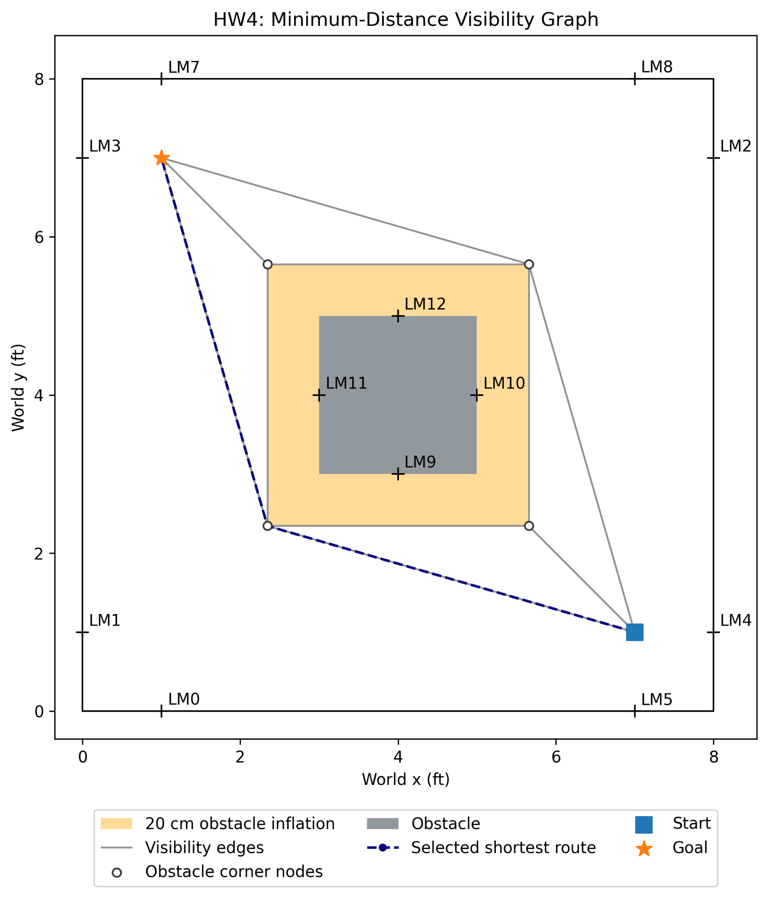
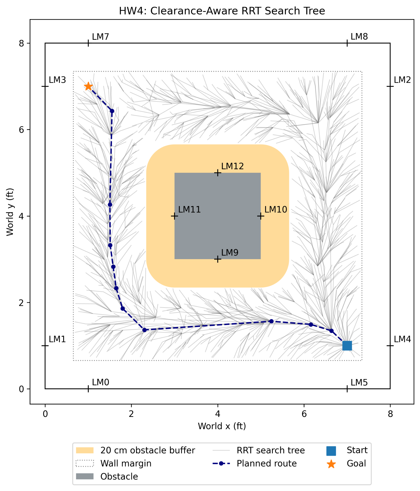
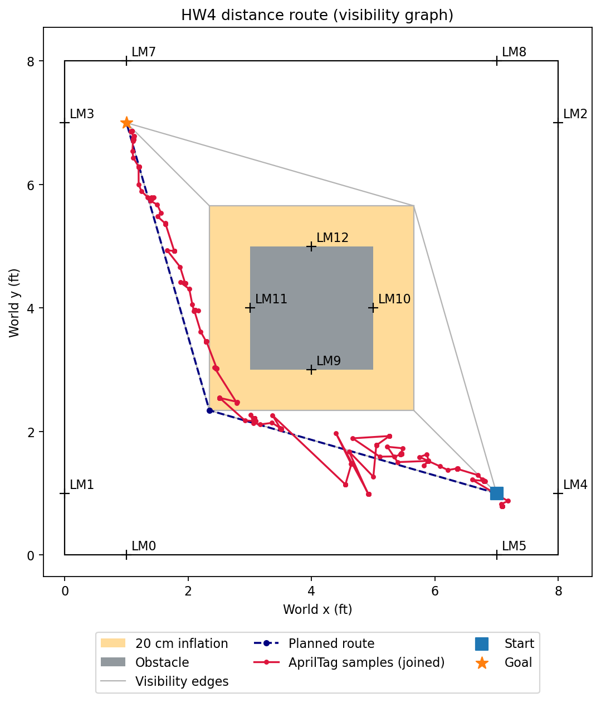
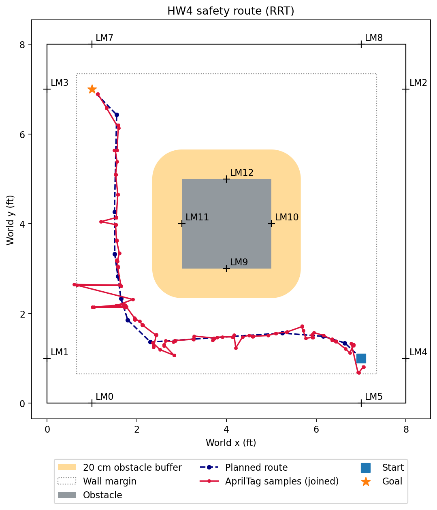

# CSE 276A — Homework 4 Report

> Markdown transcription of the submitted report. For original equation layouts, tables, and diagrams, see the [source PDF](original_pdfs/hw4_report.pdf).


<!-- Source PDF page 1 -->
```text
Xinzi Huang: 200230357
Runtong Liang: 200479676
```

## 1 System Architecture

We implemented and tested two path planners for a mobile robot: a minimum-distance planner using a visibility graph, and a maximum-safety planner using a clearance-weighted rapidly exploring random tree (RRT). Both planners navigate around a known central obstacle and use the same AprilTag-based closed-loop waypoint controller, allowing us to compare planning strategies under similar feedback and motor-control conditions.

Figure 1 summarizes the implemented plan–execute–observe–correct pipeline. The selected planner produces a fixed sequence of XY waypoints using either a visibility graph or a clearance-aware RRT. Before moving toward each waypoint, the robot obtains an AprilTag position and heading estimate. It turns toward the waypoint, drives forward a short distance, stops, and acquires another localization fix. Thus, the controller corrects its motion iteratively, rather than driving the entire route open-loop.

```text
Camera and
image processing
```

```text
Calibrated images
```

```text
AprilTag detector
```

```text
Camera-to-tag poses
Known map,
Robot pose     Known transforms            Robot motion changes                                                           obstacle,
estimation                 camera viewpoint                                                         start and goal
```

```text
Estimated x, y, θ
```

```text
Path planner                                                   XY waypoints
Waypoint controller                          (Visibility
graph / RRT)
Turn / forward
commands
Motor controller
and robot
```

*Figure 1: Closed-loop system architecture for HW4. The selected planner generates XY waypoints using either a*

visibility graph or a clearance-aware RRT. The robot estimates its pose from AprilTag observations and known landmark transforms. The waypoint controller repeatedly corrects heading and position using new localization measurements after each short movement.

Localization. Twelve tag36h11 AprilTags (using the actual detector IDs) are placed around the outer boundary and on the central obstacle. Their known global poses are used for localization.

For each visible tag with a known world transform, the camera-to-tag transform from ROS /tf is combined with the camera mounting offset and known tag transform to estimate the robot’s planar pose ˆx = (ˆx, ˆy, ˆθ). Invalid (e.g. outside-arena) and geometrically inconsistent estimates are rejected. After stopping for 0.5 s, the controller gathers up to five fresh pose samples, finds the largest cluster within 0.10 m, and accepts a fix only if at least three samples agree. The reported XY position is the cluster median; heading is the circular mean. A dead-reckoning consistency gate initially rejects fixes more than 0.40 m from the predicted pose, but is relaxed after repeated failed localization

<sub>Source page 1 of 9 · [View original PDF](original_pdfs/hw4_report.pdf#page=1)</sub>

---

<!-- Source PDF page 2 -->
attempts. If no fix is available, the robot rotates in 20◦increments to search for tags.

Waypoint controller. Given the current localized pose (x, y, θ) and target (xw, yw), the controller computes

```text
d = √︁ (xw −x)2 + (yw −y)2,      θtarget = atan2(yw −y, xw −x),   ∆θ = wrap(θtarget −θ).        (1)
```

It turns by ∆θ and commands min(0.20, d) m of forward travel, using calibrated time-based motor commands. This

```text
loop repeats until d ≤0.08 m, at which point the next waypoint is selected.
```

## 2 World Representation

### 2.1 Configuration-Space Model

We represent the environment using a two-dimensional metric configuration space. Although the robot’s full planar pose is (x, y, θ), our path planners operate only on its position, so a configuration is defined as

```text
p = (x, y) ∈C ⊂R2.                                             (2)
```

```text
The robot’s orientation θ is handled separately by the closed-loop waypoint controller.
```

The workspace is an 8 ft × 8 ft square in world coordinates, with the lower-left corner at (0, 0):

```text
C = [0, 8] × [0, 8].                                               (3)
```

A 2 ft × 2 ft central rectangular obstacle occupies O = [3, 5] × [3, 5] ft. For collision avoidance, we inflate the obstacle

```text
by δ = 0.20 m ≈0.656 ft on all sides:
```

```text
Cobs = [3 −δ, 5 + δ] × [3 −δ, 5 + δ].                                      (4)
```

The safety planner additionally evaluates clearance from the four arena walls. The dashed wall-margin boundary in Fig. 3b marks the corresponding 0.20 m inset. We also apply the same margin to the workspace boundary, defining the admissible configuration space as

```text
Cfree = [δ, 8 −δ]2 \ int(Cobs).                                         (5)
```

Given the initial configuration ps = (7, 1) ft and goal configuration pg = (1, 7) ft, the planning problem is to find a continuous collision-free path

```text
π : [0, 1] →Cfree,                                                (6)
```

such that

```text
π(0) = ps,     π(1) = pg,     π(t) ∈Cfree  ∀t ∈[0, 1].                            (7)
```

Motivation for representation. Since our environment is static, planar, and known in advance, a continuous geometric configuration-space representation is sufficient for both planning objectives.

Unlike an occupancy grid, this representation does not require discretizing the workspace into fixed-resolution cells, thereby avoiding discretization errors and resolution-dependent motion directions. Furthermore, the rectangular obstacle representation allows efficient line-segment collision checking and direct computation of clearance from both the obstacle and workspace walls.

### 2.2 Search Representations

Both planning methods share this configuration-space representation, but differ in their search representations and optimization objectives.

For minimum distance, we construct a visibility graph with vertices at the start, goal, and four inflated-obstacle corners. It tries to minimize the total Euclidean path length:

```text
∫︂
π∗dist = arg min     ds.                                            (8)
π⊂Cfree  π
```

<sub>Source page 2 of 9 · [View original PDF](original_pdfs/hw4_report.pdf#page=2)</sub>

---

<!-- Source PDF page 3 -->
For maximum safety, we construct an RRT sample tree in the free XY space. The planner minimizes a weighted path cost that penalizes proximity to both the central obstacle and the workspace walls:

```text
∫︂
π∗safety ≈arg min     wsafety(p) ds,                                      (9)
π⊂Cfree  π
```

where wsafety(p) increases as the clearance to obstacles or walls decreases. The exact cost function is defined in the following section.

## 3 Planning Algorithms

#### Planner visualizations





## a. Visibility graph for minimum-distance planning. Gray    (b) RRT exploratory tree for maximum-safety planning. Gray

edges connect mutually visible vertices, and white circles     line segments are tree edges explored during sampling, and indicate the four corners of the inflated obstacle. The blue    the blue dashed path is the final route returned after costdashed line represents the shortest path selected by Dijkstra.    based shortcutting.

### 3.1 Minimum Distance: Visibility Graph and Dijkstra’s Algorithm

We use a visibility graph to find the shortest collision-free path in the known polygonal environment. The key idea is that the shortest path around polygonal obstacles consists of straight-line segments connecting visible vertices.

Motivation for algorithm selection. We choose a visibility graph because the environment contains only a small number of known polygonal obstacles. Under our geometric configuration-space model, a shortest collision-free path can be constructed from straight-line segments connecting visible vertices. Consequently, only six vertices are required to represent the relevant search space.

Compared with grid-based methods such as A* or wavefront planning, the visibility graph avoids discretizationdependent paths and unnecessary exploration of free-space cells. Since all graph edges have nonnegative Euclidean weights, Dijkstra’s algorithm provides a deterministic and globally optimal solution to the geometric shortest-path problem in this environment.

<sub>Source page 3 of 9 · [View original PDF](original_pdfs/hw4_report.pdf#page=3)</sub>

---

<!-- Source PDF page 4 -->
Visibility. Two configurations pi, pj ∈Cfree are visible if the straight-line segment between them does not intersect the interior of the inflated obstacle. We define this segment as

```text
ℓij(t) = (1 −t)pi + tpj,      t ∈[0, 1].                                  (10)
```

The visibility condition is therefore

```text
ℓij(t) /∈int(Cobs),     ∀t ∈[0, 1].                                     (11)
```

This allows edges to touch the inflated-obstacle boundary but not pass through its interior.

Graph construction. We construct an undirected weighted graph G = (V, E), where the vertex set consists of the start configuration, goal configuration, and four corners of the inflated obstacle:

```text
V = {ps, pg} ∪{c1, c2, c3, c4}.                                      (12)
```

For every pair of distinct vertices (pi, pj), an edge is added if the visibility condition 11 is satisfied:

```text
E = {(pi, pj) ∈V × V  | i < j, ℓij(t) /∈int(Cobs) ∀t ∈[0, 1]} .                       (13)
```

The edge weight is its Euclidean length:

```text
wdist(pi, pj) = ∥pj −pi∥2.                                        (14)
```

Shortest-path search. We apply Dijkstra’s algorithm to find the minimum-cost path from ps to pg. Starting with D(ps) = 0 and D(p) = ∞for all other vertices, we repeatedly select the unvisited vertex with the smallest tentative distance and relax its outgoing edges:

```text
D(pj) ←min {D(pj), D(pi) + wdist(pi, pj)} .                              (15)
```

Once the goal is reached, we reconstruct the shortest path using the predecessor pointers.

The resulting path minimizes the sum of its edge lengths:

```text
π∗dist = arg min  ∑︂   wdist(pi, pj),                                  (16)
π∈PG
(pi,pj)∈π
```

where PG denotes all paths from ps to pg in graph G.

Planning result. As illustrated in Fig. 2a, the selected shortest route is

```text
(7, 1) →(2.344, 2.344) →(1, 7)       [ft],                                  (17)
```

with a planned length of 9.692 ft = 2.954 m. It passes close to the lower-left corner of the inflated obstacle, achieving the shortest geometric distance under the specified obstacle inflation. However, the visibility graph does not explicitly optimize additional obstacle clearance, so the resulting route may be less robust to localization and motion errors than the clearance-aware RRT.

### 3.2 Maximum Safety: Clearance-Weighted RRT

Unlike minimum-distance planning, maximum-safety planning aims to find a route that maintains greater clearance from obstacles and workspace boundaries. To achieve this, we implement a sampling-based Rapidly-exploring Random Tree (RRT) that explores the free configuration space Cfree and penalizes paths passing close to obstacles.

Motivation for algorithm selection. For our known two-dimensional environment, a Voronoi roadmap or a distance-transform grid search with A* are also suitable for safety planning. However, we chose a sampling-based planner for three reasons.

- RRT operates directly in continuous space, allowing us to balance path length and clearance without relying
on a fixed grid or predefined roadmap. Our initial grid-based planner produced a long segment along x = 7 ft, maintaining only 1.0 ft of clearance from the right wall. This motivated us to adopt a continuous sampling-based approach with a clearance-weighted objective to better exploit the available free space.

<sub>Source page 4 of 9 · [View original PDF](original_pdfs/hw4_report.pdf#page=4)</sub>

---

<!-- Source PDF page 5 -->
- Our safety objective combines both the central obstacle and workspace walls into a unified clearance function
d(p). The same planning framework can accommodate additional or irregularly shaped obstacles by adapting the clearance and collision-checking functions.

- Although RRT introduces stochastic variability, we use a fixed random seed for reproducibility. Across 30 different
seeds, the planner generated paths ranging from 3.19 to 3.38 m, demonstrating relatively consistent path lengths.

Clearance definition. For a configuration p = (x, y) ∈Cfree, we define its clearance as the minimum distance to either the central obstacle or the workspace walls:

```text
dbox(p) = √︁ max(3 −x, x −5, 0)2 + max(3 −y, y −5, 0)2,                        (18)
dwall(p) = min(x, 8 −x, y, 8 −y),                                                 (19)
d(p) = min{dbox(p), dwall(p)}.                                                (20)
```

All distances in Eq. (20) are in feet. The clearance d(p) is measured relative to the original obstacle and walls, rather than the inflated obstacle. A minimum clearance of δ = 0.20 m ≈0.656 ft is enforced during edge evaluation.

Safety-weighted cost. For two configurations pi, pj ∈Cfree, we consider the straight-line segment pi →pj as

```text
ℓij(t) = (1 −t)pi + tpj,      t ∈[0, 1].                                  (21)
```

An edge is considered feasible if it does not intersect the inflated obstacle and satisfies the minimum 0.20 m clearance at the sampled configurations:

```text
d(ℓij(tk)) ≥δ,    k = 0, . . . , N.                                     (22)
```

To favor paths with greater clearance, we define a configuration-dependent weight:

```text
8
wsafety(p) = 1 +                        .                                     (23)
(d(p) + 0.25)2
```

The first term penalizes overall route length, and the weight increases as the clearance decreases. Thus, the cost of a feasible edge is

```text
[︄         8          ]︄                                                           ∫︂                                  ∫︂
J(pi, pj) =        wsafety(p) ds =     1 +                  ds,                     (24)
pi→pj                         ℓij            (︁ d(p) + 0.25)︁2
```

and J(pi, pj) = +∞for an infeasible edge.

The integral is evaluated by a trapezoidal rule with approximately 0.10 ft sampling intervals:

```text
N−1     ]︄                                                                                 [︄                                            w0 + wN
∑︂ wk   ,                                 (25)                                    J(pi, pj) ≈Lij       +
N      2
k=1
```

where Lij = ∥pj −pi∥2, N = max(2, ⌈Lij/0.10⌉), and wk = wsafety(ℓij(k/N)). In particular, the planner does not simply select the point farthest from the obstacle: both wall proximity and the accumulated cost along the entire trajectory matter.

Search procedure. Our RRT planner uses the following steps:

1. Initialize a tree T = (VT , ET ) rooted at the initial configuration ps. Each vertex pi ∈VT stores a parent and accumulated cost D(pi).

2. For 2000 iterations, sample a random configuration prand within the wall-margin boundary. With probability 0.10, the goal pg is selected instead to encourage exploration toward the destination.

3. Find the tree node geometrically nearest to the sample:

```text
pnear = arg min ∥pi −prand∥2.                                   (26)
pi∈VT
```

and extend toward the sampled configuration by at most 0.5 ft:

```text
(︃         0.5        )︃
pnew = pnear + α(prand −pnear),   α = min  1,                              .                 (27)
∥prand −pnear∥2
```

Discard the extension if its connecting segment is infeasible under Eq. (24).

<sub>Source page 5 of 9 · [View original PDF](original_pdfs/hw4_report.pdf#page=5)</sub>

---

<!-- Source PDF page 6 -->
4. Among the 20 existing tree nodes nearest to the new point (denoted as N20(pnew)), choose the feasible parent that minimizes accumulated tree cost plus the new edge cost:

```text
p∗parent = arg   min    [D(pi) + J(pi, pnew)] .                            (28)
pi∈N20(pnew)
```

The accumulated cost of the new vertex is then

```text
D(pnew) = D(p∗parent) + J(p∗parent, pnew).                               (29)
```

Insert the node.

5. Test whether the newly inserted node can connect directly to the goal. If feasible, the total candidate path cost is

```text
Jgoal = D(pnew) + J(pnew, pg).                                    (30)
```

Retain the lowest-cost complete path found across the search, instead of returning immediately upon finding the first feasible path.

6. After extracting the best route, apply cost-based shortcutting. Given consecutive path vertices pi, . . . , pj, a direct connection replaces the intermediate segments only when it is feasible and satisfies:

```text
j−1
J(pi, pj) < ∑︂ J(pk, pk+1).                                     (31)
```

```text
k=i
```

The resulting route therefore reduces the accumulated clearance-weighted cost without violating the collision constraints.

Planning result. As shown in Fig. 2b, the RRT explores multiple feasible regions around the obstacle before selecting a route along its lower and left sides.

The resulting path has a total planned length of 3.344 m, approximately 13.2% longer than the visibility-graph route (2.954 m). This additional distance reflects the trade-off between geometric efficiency and clearance-aware planning.

Our implementation is a cost-aware RRT variant with local parent selection and shortcut optimization, rather than a full RRT* algorithm, since existing tree vertices are not rewired. Furthermore, the safety objective minimizes an integrated clearance penalty, rather than directly maximizing the minimum clearance along the entire path.

Stochastic nature of RRT. Unlike the deterministic visibility graph, the RRT is a sampling-based planner whose resulting route depends on the random seed. To evaluate its variability, we ran the planner with 30 different random seeds under the same environment and planning parameters.

Although different random seeds produce different waypoint sequences, all 30 sampled runs maintain greater minimum interior clearance than the visibility-graph route. This suggests that the clearance-weighted objective consistently favors safer planned routes in our tested environment.

For reproducibility, we use a fixed random seed of 276 for the reported robot experiments.

```text
Planner  Waypoints    Length (m)    Min interior clearance (ft)  Mean clearance (ft)
```

```text
RRT      8.8 (6–12)   3.28 (3.19–3.38)        1.35 (1.13–1.46)          1.44 (1.38–1.48)
```

*Table 1: RRT planning variability across 30 random seeds. Values are reported as mean (min–max). “Interior”*

excludes the first and last 1 ft, where the endpoints limit the clearance to 1.0 ft.

## 4 Results and Discussion

#### Executed routes and AprilTag localization samples





Figures 3a and 3b compare the blue planned paths with the red sequences of AprilTag localization samples from representative runs. Note that the red joined samples are localization observations, not an uninterrupted high-frequency ground-truth trajectory.

<sub>Source page 6 of 9 · [View original PDF](original_pdfs/hw4_report.pdf#page=6)</sub>

---

<!-- Source PDF page 7 -->
## a. Visibility-graph shortest route.  Gray segments show     (b) Clearance-aware RRT route. Orange marks the obstacle

candidate visibility edges.                                        buffer and dotted lines mark the wall margin.

Both modes successfully navigate around the obstacle toward the goal. The safety plan stays relatively farther from the inflated obstacle near its lower-left side, while the minimum-distance plan takes a more direct diagonal approach to the buffered corner. However, the lower-left route is arbitrary, because the upper-right route has identical clearance by symmetry. And in our experiments, the robot can choose either the lower-left route or the upper-right route depending on the randomized exploration of RRT.

### 4.1 Why the Measured Trajectories Scatter

The red traces show occasional jumps, loops, and points away from the smooth blue path. Several aspects of the implementation explain why this can occur:

- Joining discrete detections: The plotting routine draws a line between successive saved AprilTag estimates,
including points collected while the robot is stopped and re-localizing. Connecting them gives the appearance of rapid side-to-side motion even if the robot did not physically follow that line.

- Tag-dependent localization noise and bias: Different viewing distances, angles, tag detections, and camera-
to-robot transformations can yield slightly different global pose estimates. Switching which tag supplies a pose may create abrupt apparent shifts.

- Raw samples versus accepted fixes: The CSV saves individual accepted tag samples; the controller navigates
using a median of a consistent cluster of observations. Consequently, plotted red samples need not match the filtered pose used to decide the next motor command.

- Measurement and waypoint tolerances: The consistency cluster allows poses within 0.10 m, and the controller
considers a waypoint reached within 0.08 m. A nonzero final error is therefore expected even with successful closed-loop operation.

The plotted scatter alone does not distinguish actual motion deviations from localization errors. However, during our experiments, the robot’s physical motion was visually much smoother than the plotted trajectories suggest, as demonstrated in the recorded videos.

The observed scatter therefore does not appear to significantly affect the robot’s overall navigation performance. Despite occasional fluctuations in the AprilTag-based pose estimates, the closed-loop controller successfully corrects

<sub>Source page 7 of 9 · [View original PDF](original_pdfs/hw4_report.pdf#page=7)</sub>

---

<!-- Source PDF page 8 -->
motion deviations and guides the robot toward the goal.

### 4.2 Endpoint Accuracy Across Three Trials

We recorded the displacement (∆x, ∆y) (in centimeters) from the scheduled endpoint to the robot’s actual endpoint after each run. We compute the magnitude of each error as e = √︁ ∆x2 + ∆y2, and summarize accuracy by the mean

```text
√︂ 1¯e and root mean square error RMSE =                                        ∑︁3i=1 e2i .                                               3
```

```text
Trial 1             Trial 2             Trial 3
```

```text
Method           (∆x, ∆y)    e    (∆x, ∆y)    e    (∆x, ∆y)    e   Mean e  RMSE
```

```text
Minimum distance   (−4, 1)    4.12   (−6, 0)    6.00   (−3, −2)   3.61    4.58      4.69
Maximum safety    (−2, −4)   4.47   (−1, −5)   5.10    (1, −4)    4.12    4.56      4.58
```

*Table 2: Final-position displacement (∆x, ∆y), error magnitude e, mean error, and RMSE over three trials (cm).*

Both methods finish with roughly 4.6 cm average endpoint error. The consistently negative x displacement in the distance runs and negative y displacement in the safety runs suggest route-dependent directional biases, although three trials are insufficient to identify their underlying causes.

### 4.3 Execution Time Analysis

We also recorded the elapsed time of each experimental run to evaluate the execution efficiency of the two planning methods. Table 3 summarizes the results across three trials.

```text
Execution time (s)
```

```text
Method              Trial 1   Trial 2   Trial 3  Mean   Std. dev.  Waypoints  Path Length (m)
```

```text
Minimum distance    71      72      75     72.67      2.08         3             2.954
Maximum safety     119     124     132    125.00     6.56        12            3.344
```

*Table 3: Execution time, number of waypoints, and planned path length comparison across three trials.*

The maximum-safety route takes an average of 125.00 s to execute, compared with 72.67 s for the minimum-distance route. This corresponds to an increase in execution time of

```text
125.00 −72.67
× 100% ≈72.0%.                                     (32)
72.67
```

Although the maximum-safety route is only approximately 13.2% longer, its execution time is significantly greater. One possible explanation is the larger number of waypoints: the clearance-aware RRT generates 12 waypoints, whereas the visibility graph produces only 3, including the start and goal. The additional intermediate waypoints create more opportunities for heading corrections, short forward movements, stopping, and AprilTag-based localization.

The visibility graph is therefore preferable when travel distance and execution efficiency are the primary objectives.

### 4.4 Safety Analysis

The visibility graph is deterministic and efficient for our simple, known polygonal environment. It produces the shortest geometric route, but its path follows the edge of the obstacle’s inflated boundary at a corner.

The clearance-weighted RRT is more flexible about searching open space and explicitly considers walls as well as obstacles, but samples many candidates and returns a longer route. Because the safety objective is an integrated

<sub>Source page 8 of 9 · [View original PDF](original_pdfs/hw4_report.pdf#page=8)</sub>

---

<!-- Source PDF page 9 -->
penalty rather than a hard guarantee of maximum minimum clearance, the chosen path is not necessarily the globally safest conceivable route.

To quantitatively evaluate this trade-off, we sample both planned routes at intervals of 0.05 ft and calculate the clearance d(p) defined in Eq. (20). Given N equally spaced samples along a planned path, the minimum and mean clearances are approximated by

```text
N
1
dmin(π) = min  d(pi),      ¯d(π) =  ∑︂ d(pi).                             (33)
1≤i≤N          N
i=1
```

As shown in Table 4, the clearance-aware RRT produces a route that is approximately 13.2% longer, but increases the minimum interior clearance from 0.81 ft to 1.36 ft, an improvement of approximately 68% (0.168 m). The mean clearance also increases from 1.15 ft to 1.46 ft, an improvement of approximately 27% (0.094 m).

Route           Length (m)  Waypoints  Min interior clearance (ft)  Mean clearance (ft)  Mean time (s)

```text
Visibility graph      2.954         3                  0.81                     1.15              72.67
RRT (seed 276)      3.344         12                 1.36*                     1.46              125.00
```

∗Excluding the first and last 1 ft of the path. The endpoints are 1.0 ft (0.305 m) from the walls, resulting in a whole-route minimum clearance of 0.305 m for the RRT route.

*Table 4: Quantitative comparison of planned routes.*

These results demonstrate that the clearance-aware RRT is more suitable when additional obstacle clearance is prioritized.

## 5 Run Videos

Minimum-distance run: [Insert video URL here] Maximum-safety run: [Insert video URL here]

<sub>Source page 9 of 9 · [View original PDF](original_pdfs/hw4_report.pdf#page=9)</sub>

---

## Key results (structured reference)

| Metric | Visibility graph | Clearance-aware RRT (seed 276) |
|---|---:|---:|
| Planned length | 2.954 m | 3.344 m |
| Number of waypoints | 3 | 12 |
| Mean execution time (3 trials) | 72.67 s | 125.00 s |
| Mean endpoint error (3 trials) | 4.58 cm | 4.56 cm |
| Minimum interior clearance | 0.81 ft | 1.36 ft |
| Mean clearance | 1.15 ft | 1.46 ft |

*Interior clearance excludes the first and last 1 ft; endpoints constrain whole-route clearance.*

**Demo videos:** The submitted HW4 report still contains placeholders for both video URLs; no links have been invented here.
